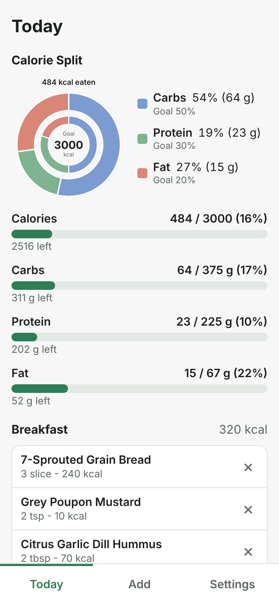
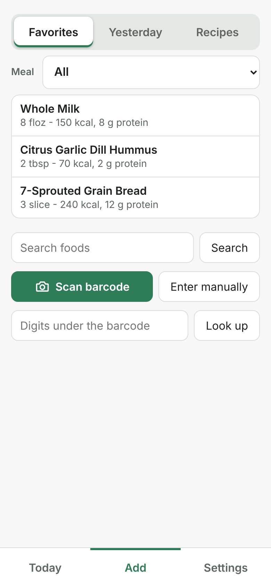
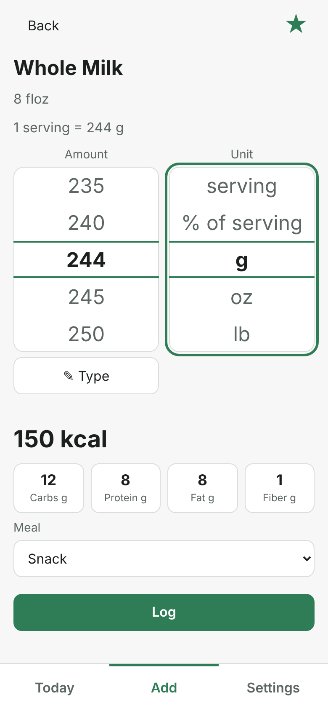
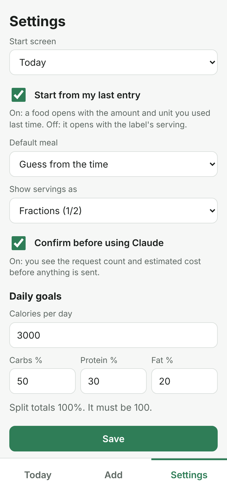
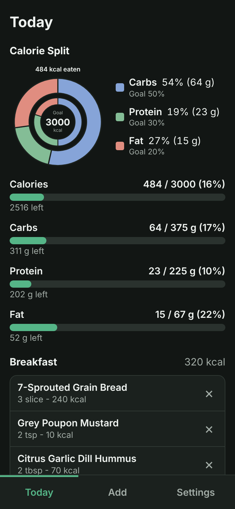
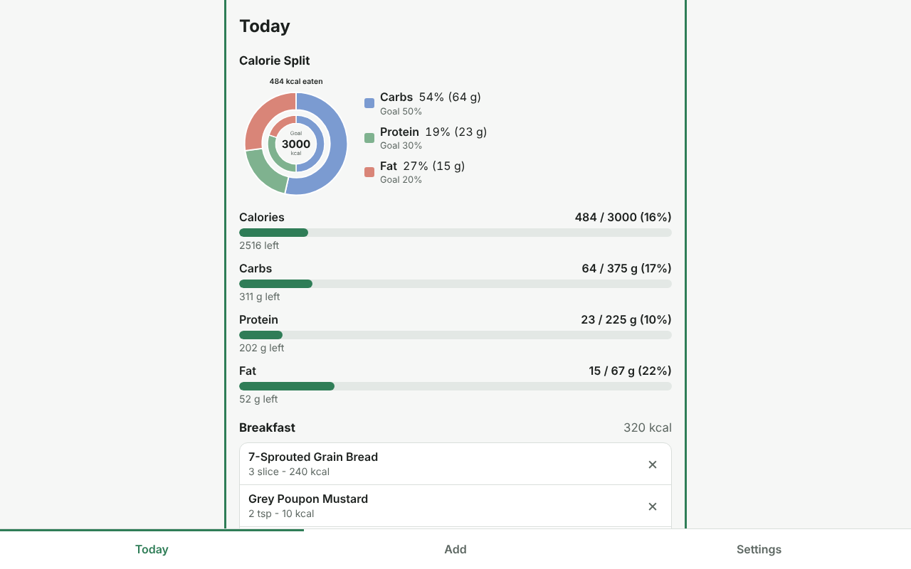
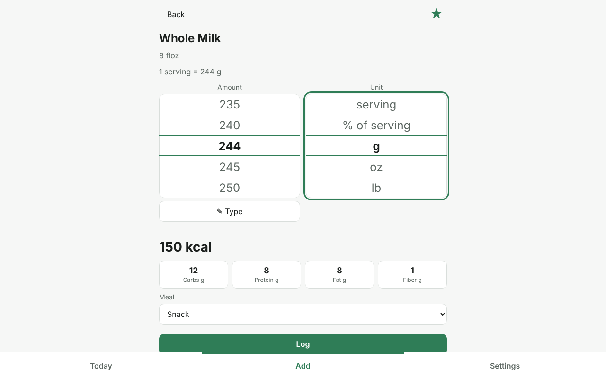

# Macrolog

Macrolog is a small self-hosted calorie and macro tracker for a household. It is built to be quick: pick up the phone, find the food, enter the amount, put the phone down. It works without any AI service. Claude is an optional helper that reads nutrition labels from photos.

## Screenshots

| Today | Add | Picker | Settings |
| --- | --- | --- | --- |
|  |  |  |  |

Dark mode follows the device setting, and the layout also works on desktop.





## Features

- Log food by searching, by scanning a barcode, or from favorites, yesterday's entries and saved recipes, with a Meal selector to show one meal at a time.
- Barcode lookups use Open Food Facts first, then USDA FoodData Central branded foods. Text search uses USDA FoodData Central. While you type, the search box looks only at your own foods and favorites (`remote=0`). Pressing Enter or the Search button also queries USDA (`remote=1`). Every food found is saved in your own database.
- Nutrients are stored per label serving. The amount picker offers the units the label allows, with grams, ounces, cups and tablespoons converted where the label makes that possible. Conversions that rely on an estimate are marked as estimated.
- Custom foods can be created by hand.
- The Today screen shows calorie and macro bars against your targets, with entries grouped by meal.
- Each user has their own daily goal (calories and the carb, protein and fat split) and start screen.
- Barcode scanning uses the browser's BarcodeDetector when it exists. Otherwise a vendored ZXing decoder (Apache-2.0, in `app/static/vendor`) loads on demand, then a photo fallback, then typed digits.
- Light and dark themes follow the system setting.
- Optional: Claude reads a nutrition label from one to three photos. You check the draft before anything is saved.
- Sign in with a local password, with optional single sign-on through OpenID Connect (authentik), set up entirely from the Admin page.
- An Admin page for users, sign-in, Claude and food database settings, with lockout safeguards and an audit log.

## Using the app

The same guide is in Settings under "How to use Macrolog".

- Tap Add, then pick from Favorites, Yesterday or Recipes, or search, scan, or type the barcode digits. Set the amount and tap Log.
- The Meal selector on Add filters the lists by meal. All shows everything.
- In the picker, the wheel chooses the unit, and the chips set 1/4 to 2 servings. Macros update live.
- A food opens with the amount and unit from your last entry. Turn this off in Settings with "Start from my last entry" to open on the label's serving instead.
- Tap the star to make a favorite. On Today, "Save today as a recipe" makes a recipe you can log later.
- If a food is not found, ask Claude to read the label photo (if set up) or enter it manually, and check the numbers.
- Each user has their own log, goals and settings. Foods are shared.
- Settings also holds your own Claude key and limit, and Connect SSO when the server offers it. Administrators see an Admin page there for users, sign-in, Claude and USDA keys, and recent activity.

## Quick start

You need Docker with the Compose plugin.

```
cp .env.example .env
# Edit .env and set SECRET_KEY (and PUBLIC_URL if you will use single sign-on)
docker compose up -d --build
```

Open http://localhost:8000. On a fresh install the app shows a one-time setup screen: choose a username and a password (at least 8 characters) and you are signed in as the first administrator. Everything else, including more users and single sign-on, is set up from the Admin page. The port is published on `127.0.0.1` only. See the reverse proxy section to expose it.

The setup screen is available only while there are no users at all, and only once. Anyone who can reach the app before you finish setup could claim it, so complete it right after the first start, before exposing the app. As an alternative, set `ADMIN_USER` and `ADMIN_PASSWORD` in `.env` and the first administrator is created at startup instead.

**First account and single sign-on.** While there are no users, a sign-in through SSO never creates the first administrator when password sign-in is on: it is refused with "Finish first-run setup first", so a stranger at your identity provider cannot claim the app. If password sign-in is off (`LOCAL_LOGIN=0`) and SSO is configured in `.env`, there is no setup screen. `POST /api/auth/setup` answers 409 ("Password sign-in is off. Sign in with SSO to create the first admin"), and the first SSO sign-in creates the first user as administrator, even when `OIDC_ALLOW_SIGNUP=0`. It is written to the audit log. `GET /api/auth/config` reports `needs_setup` for the setup screen case and `first_admin_via_sso` for the SSO case.

## Configuration

All settings can be given as environment variables in `.env`. Anything left empty uses the default shown. The settings marked "live" can also be changed by an administrator in the app, and a value saved there takes precedence over `.env`. See [Administration](#administration).

| Variable | Default | Purpose |
|---|---|---|
| `SECRET_KEY` | none, required | Signs the session cookie. Must be at least 32 characters or the app refuses to start. Changing it signs everyone out. |
| `DB_PATH` | `/data/macrolog.db` in the image | SQLite database file. The image places it on the `macrolog-data` volume. |
| `LOCAL_LOGIN` | `1` | Live. Set to `0` to turn off password sign-in. Do this only when SSO is configured. |
| `ADMIN_USER`, `ADMIN_PASSWORD` | empty | Optional alternative to the first-run setup screen. Creates this user as an administrator at startup, only while the users table is empty. The password needs at least 8 characters. `ADMIN_USER` is also made an administrator at every start, but only when that account has a password, and an SSO sign-up is never given that name. Remove both after the first start. |
| `OIDC_ISSUER` | empty | Live. authentik issuer URL, for example `https://auth.example.com/application/o/macrolog/`. SSO stays off unless the issuer, the client ID and `PUBLIC_URL` are all set. |
| `OIDC_CLIENT_ID` | empty | Live. Client ID of the authentik provider. |
| `OIDC_CLIENT_SECRET` | empty | Live, secret. Client secret for a confidential client. Sent only when set. |
| `OIDC_NAME` | `authentik` | Live. Label on the sign-in button. |
| `OIDC_ALLOW_SIGNUP` | `0` | Live. `0` refuses SSO logins that do not match an existing account (linked with Connect SSO, or by verified email). `1` lets any successful SSO login create an account. |
| `PUBLIC_URL` | empty | Public address of the app, for example `https://macrolog.example.com`. Used for the SSO redirect URI and as the expected origin for state-changing requests. |
| `TRUST_PROXY` | `0` | Set to `1` behind your own reverse proxy. The login rate limit then reads the client address from the last `X-Forwarded-For` entry. |
| `COOKIE_SECURE` | `0` | Set to `1` when the site is served over HTTPS, so the session cookie is marked Secure. |
| `ANTHROPIC_API_KEY` | empty | Live, secret. The household Claude key. Users can also add their own key, see the Claude section. |
| `AI_MODEL` | `claude-haiku-5-5` | Live. Model used for label reading. Haiku is recommended. Only Haiku models are forced to use the label tool. Other models are allowed to choose, and a reply without the tool result is shown as an error. |
| `AI_MONTHLY_REQUEST_CAP` | `100` | Live. Requests allowed per calendar month with the household key, counted for the whole household. |
| `AI_PRICE_IN_PER_MTOK` | empty | Live. Input price of the model in USD per million tokens. Used only to show costs. Set both price variables, or the app shows "Cost not available". Look up the current price on Anthropic's pricing page. |
| `AI_PRICE_OUT_PER_MTOK` | empty | Live. Output price of the model in USD per million tokens. |
| `FDC_API_KEY` | `DEMO_KEY` | Live, secret. USDA FoodData Central key. An empty value means `DEMO_KEY`. Use a real free key from https://api.data.gov/signup/ because `DEMO_KEY` is heavily rate limited. |

Generate a `SECRET_KEY` with:

```
python3 -c "import secrets; print(secrets.token_urlsafe(48))"
```

## Adding users

Administrators create users in Admin > Users: username, optional display name and email, a password of at least 8 characters, and optionally administrator rights. The same page changes names and emails, resets passwords, allows or refuses the household Claude key, unlinks single sign-on and disables accounts. See [Administration](#administration).

Usernames are lowercased and may contain letters, digits, `.`, `_`, `-` and `@`, up to 64 characters, and are unique regardless of case. Passwords must be 8 to 1024 characters. Five failed sign-ins for one username, or twenty from one address, within 15 minutes trigger a temporary block. Attempts are refused until enough of those failures are more than 15 minutes old.

## Single sign-on with authentik

Everything is done in the browser. `PUBLIC_URL` must be set in `.env` (it fixes the redirect URI and cannot be changed in the app, see [Administration](#administration)).

1. **Open Admin > Sign-in in Macrolog.** It shows the exact redirect URI to give authentik, `PUBLIC_URL/auth/oidc/callback`, and a checklist of the authentik settings. If `PUBLIC_URL` is not set, the page says so instead of showing a URI.
2. **Create the provider in authentik.** Create an OAuth2/OpenID Provider with:
   - Client type: Confidential.
   - Redirect URIs: Strict, with the redirect URI from step 1, for example `https://macrolog.example.com/auth/oidc/callback`.
   - Signing Key: an RS256 certificate (the authentik self-signed certificate works). Leave the encryption key empty, because Macrolog reads only signed ID tokens.
   - Scopes: `openid`, `email` and `profile`.
   - "Include claims in id_token" turned on.

   Then create an Application that uses the provider. Its slug sets the issuer, `https://auth.example.com/application/o/<slug>/`.
3. **Paste the values into Admin > Sign-in.** Issuer (with the trailing slash, as shown on the provider page as OpenID Configuration Issuer), client ID and client secret, and optionally the button label. Save.
4. **Test connection.** The test fetches the provider's discovery document and signing keys, checks that the issuer matches exactly, and records a pass for these exact values. It cannot check the client secret, which authentik checks at the first real sign-in.
5. **Connect SSO in Settings.** While still signed in with your password, open Settings and choose Connect SSO. You are sent to authentik and back, and your Macrolog account is now linked to your authentik login. Each user can do the same for their own account. This does not depend on email addresses. Settings also has Disconnect SSO, available while the account still has a password.
6. **Optionally turn off password sign-in** in Admin > Sign-in. This is refused until the test has passed for the current values and at least one active administrator has connected SSO.

Macrolog accepts ID tokens signed with RS256, RS384, RS512, PS256 to PS512, ES256 to ES512 and EdDSA. It checks the issuer, audience, expiry, subject and nonce, and it uses PKCE with state. When connecting from Settings, the state and nonce are tied to the signed-in session, so the link can only finish in the same session of the same user.

**How accounts are matched at SSO sign-in.** Macrolog tries these steps in order:

1. Find the account already linked to this issuer and subject pair (by Connect SSO, or by an earlier sign-in). A link belongs to the identity provider it was made with, so the same subject from a different issuer is a different login.
2. If the ID token has an email and `email_verified` is exactly `true`, find the local accounts with that email that are not yet linked to SSO. Link the login only when exactly one account matches. This link is recorded in the audit log as `sso.linked_by_email`.
3. Otherwise create a new account, using `preferred_username`, or the part of the email before the `@`. If that name is taken, a number is added. This happens only when "Allow sign-up through SSO" is on (`OIDC_ALLOW_SIGNUP=1`). When it is off, which is the default, the login is refused.

Connect SSO in Settings is the simplest way to link existing accounts. Matching by email (step 2) is an alternative for people who never sign in with a password: an administrator creates the account with the same email that authentik has, and the first SSO sign-in links it, but only when the ID token says `email_verified: true`. Authentik's stock email mapping may leave that claim out. To send it, create a Scope Mapping in authentik (Customization > Property Mappings) for scope `email` with the expression `return {"email": request.user.email, "email_verified": True}`, and use it in place of the default email mapping on the provider. Only do that when you control who can have an authentik account and what email they enter, because anyone who can set their authentik email to another person's address could otherwise take over that person's Macrolog account.

## Reverse proxy and HTTPS

Run a reverse proxy that terminates TLS, such as Caddy, nginx or Traefik, and forward it to port 8000. Then set:

```
PUBLIC_URL=https://macrolog.example.com
COOKIE_SECURE=1
TRUST_PROXY=1
```

Set `TRUST_PROXY=1` only when the proxy is the only route to port 8000. Otherwise clients can send their own `X-Forwarded-For` header and get around the per-address login limit. Phone browsers allow the camera only on HTTPS pages. Without HTTPS the app falls back to choosing a photo of the barcode, or to typing the digits.

The Compose file publishes port 8000 on `127.0.0.1` only, so a reverse proxy on the same host can reach it and nothing else can. To expose it to other machines, for example a proxy on another host or plain HTTP on your LAN, change the `ports` entry in `docker-compose.yml` to `"8000:8000"` and protect it with a firewall.

## Claude label reader (optional)

When a Claude API key is available to the signed-in user, the Not found screen offers "Ask Claude" as an option. The browser re-encodes each photo as a JPEG with at most 1280 px on the long side, and sends one to three photos with an optional barcode and a short hint. The server sends them to the Messages API with a forced tool call, which returns the label values as printed, per serving. The result is shown as an editable draft with warnings, for example when calories do not match the macros by more than 20 percent, when a serving is missing, or when a value looks implausible. Nothing is saved until you confirm. The API key is never sent to the browser and is never logged.

**Which key is used.** Each user can store a personal Claude API key in Settings. The app uses, in this order: the user's personal key, then the household key (`ANTHROPIC_API_KEY` or the administrator setting) if the administrator allows that user to use it, else Claude is off for that user. A personal key is stored encrypted, is never shown again and is not checked against the API when saved. It has its own monthly request limit, 100 by default, which the user can set from 1 to 10000. Requests with a personal key count only against that user's limit, and requests with the household key count only against the household cap.

The cap is a request count, not a money limit. `AI_MONTHLY_REQUEST_CAP` applies to household-key requests from the whole household for each calendar month. A request is counted before it is sent and released if the call fails. Requests are not retried. Each request's token counts are kept in the `ai_usage` table. The Settings screen shows how many requests are used.

Before each Claude request the app shows a notice with what will be sent, how many of the monthly requests it uses, and the estimated cost. Nothing is sent until you tap Continue. Each person can turn the notice off in Settings with "Confirm before using Claude". The estimate assumes about 1,600 input tokens per photo, 700 for the instructions and 400 output tokens. The monthly cost in Settings is computed from the real token counts stored in `ai_usage`.

Settings also has "Show servings as", which switches serving amounts between fractions (1/2) and decimals (0.5). Typing accepts both.

## Administration

Users marked as administrators see an Admin page with Users, Sign-in, Claude and Log sections. The first administrator is the one created by first-run setup, or `ADMIN_USER` if you use the environment bootstrap. If no administrator exists when the app starts, the user with the lowest id becomes one. Note that `ADMIN_USER`, when set, is made an administrator again at every start if that account has a password.

**Users.** Administrators can create local users, change names and emails, reset passwords, make or remove administrators, allow or refuse the household Claude key per user, unlink a user's single sign-on, and disable accounts. There is no delete, so history stays intact. A disabled user cannot sign in with a password or SSO, and any session they have stops working at once. Disabling, resetting a password, removing administrator rights and unlinking SSO all sign that user out everywhere. The last active administrator cannot be demoted or disabled, and nobody can disable their own account.

**What is editable live.** Password sign-in on or off, the SSO issuer, client ID, client secret, button label and sign-up, the household Claude key, model, monthly cap and prices, and the USDA key. A saved value wins over `.env`. Clearing a field back to "use environment" removes the saved value, so `.env` (or the default) applies again. Changes take effect on the next request, without a restart. The household Claude key, the USDA key and the client secret are write only: the page shows only whether each one is set, and saving an empty value clears it.

**What stays in the environment and why.** `SECRET_KEY`, `DB_PATH`, `PUBLIC_URL`, `TRUST_PROXY` and `COOKIE_SECURE` are shown read only in the Admin page (`SECRET_KEY` only as set or not set) and need a restart to change. `SECRET_KEY` signs cookies and encrypts the saved secrets, and `DB_PATH` says where the settings themselves are stored, so neither can live in the database. `PUBLIC_URL`, `TRUST_PROXY` and `COOKIE_SECURE` decide which origins, client addresses and cookies are trusted, so someone with a stolen administrator session must not be able to change them.

**Personal Claude keys.** Each user can add their own Claude API key and a monthly request limit (1 to 10000, default 100) in Settings. It is used before the household key, counts only against that user's own limit, is stored encrypted and is never shown again. Personal keys belong to the user: an administrator can refuse someone the household key, but cannot see, remove or disable a personal key.

**Secrets and SECRET_KEY.** Saved secrets and personal keys are encrypted (Fernet, with a key derived from `SECRET_KEY` by HKDF-SHA256). If you change `SECRET_KEY`, they can no longer be read. The app then treats them as unset, falls back to `.env` where there is a value, and shows a warning in the Admin page. Enter them again. Keep `SECRET_KEY` with your backups.

**Lockout safeguards.** Password sign-in can be turned off only when all of these hold: the SSO issuer and client ID are set, `PUBLIC_URL` is set, Test connection has passed for exactly those values, and at least one active administrator has connected SSO. Only administrators linked to the issuer that stays in effect count, so switching providers cannot bypass this. The SSO provider (issuer) cannot be changed at all while password sign-in is off or being turned off: the change is refused with "Turn password sign-in on before changing the SSO provider". After a provider change, accounts stay linked to the old provider until they disconnect and connect SSO again. Databases from earlier versions get the issuer recorded for existing links from the issuer configured at upgrade (links made with no issuer configured are treated as belonging to the current one until the next SSO sign-in). While password sign-in is off, the client ID cannot be blanked or changed to an untested value, and the last administrator who can sign in with SSO cannot be demoted, disabled or unlinked. Users cannot disconnect SSO from their own account while password sign-in is off or when they have no password.

**Audit log.** Every change made in the Admin page, first-run setup, every SSO connect or disconnect from Settings, and every CLI command is recorded with the time, who did it and what changed. Secret values are never recorded, only "set" or "cleared". The Admin page shows the last 50 entries.

**Emergency recovery from the command line.** Normal administration never needs the CLI. If you lock yourself out (for example SSO broke while password sign-in was off, or the only administrator was disabled), run these inside the container. They work without signing in and are recorded in the audit log:

```
docker compose exec macrolog python -m app.auth_cli unset-config local_login   # back to LOCAL_LOGIN in .env, default on
docker compose exec macrolog python -m app.auth_cli make-admin alice
docker compose exec macrolog python -m app.auth_cli remove-admin bob
docker compose exec macrolog python -m app.auth_cli enable-user alice
docker compose exec -it macrolog python -m app.auth_cli set-password alice
docker compose exec macrolog python -m app.auth_cli list-users
```

`unset-config KEY` removes any saved setting, for example `oidc_issuer`, so `.env` applies again. `remove-admin` and `disable-user` refuse to leave the app without an active administrator. `add-user`, `set-email` and `disable-user` also exist. Passwords are always read with a no-echo prompt, so use `-it` for commands that ask for one.

## Backups

All data is one SQLite file, `macrolog.db`, in the `macrolog-data` volume. While the app runs there are also `-wal` and `-shm` files next to it. Copying the raw files while the app runs can miss recent changes. Use SQLite's backup function, which is safe while the app runs:

```
docker compose exec macrolog python -c "import sqlite3; src = sqlite3.connect('/data/macrolog.db'); dst = sqlite3.connect('/tmp/backup.db'); src.backup(dst); dst.close(); src.close()"
docker compose cp macrolog:/tmp/backup.db ./macrolog-backup.db
```

You can also stop the app with `docker compose stop`, copy the volume contents, and start it again.

Saved secrets in the backup are encrypted with `SECRET_KEY`. Restoring with a different `SECRET_KEY` keeps all data, but the saved keys must be entered again.

Keep the database on local disk. Do not put the volume or `DB_PATH` on NFS or another network filesystem, because SQLite in WAL mode can corrupt its files there.

## Development

```
python3 -m venv .venv
. .venv/bin/activate
pip install -r requirements-dev.txt
python -m pytest
node --test tests/ui
```

Run pytest as `python -m pytest`, so the `app` package is on the import path. The Python tests run offline and stub the network. The browser helper tests use Node's built-in test runner and need no npm packages.

Layout: `app/` holds the FastAPI backend (`auth.py`, `admin.py`, `config.py`, `core.py`, `ai.py`, `lookup.py`, `units.py`, `db.py`). `app/static/` holds the frontend, which is plain HTML, CSS and ES modules with no build step.

## Known gaps

- The author has not tested live Open Food Facts and USDA lookups, or the camera on a real device.
- Not built yet: an iOS app, trends, and recipes built from ingredients.

## License

MIT. See [LICENSE](LICENSE).
